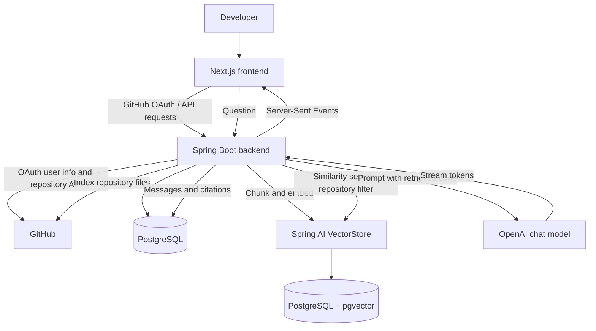

# DevPilot

**Chat with your GitHub codebase using retrieval-augmented generation (RAG).**

DevPilot is an enterprise-ready web application that indexes remote GitHub repositories into a vectorized database to provide a localized, streaming AI chat interface. 

* **Repository-Scoped Context:** Restricts vector similarity searches directly to individual repository boundaries.
* **Traceable Answers:** Renders real-time file-level citations and source code metadata mapped directly back to target files.
* **Enterprise Security:** Implements Spring Security OAuth2 combined with AES-256 equivalent database token encryption (`TextEncryptor`).

> **Repository Status:** This project is fully decoupled into a Next.js client engine and a Spring Boot backend API. Ensure you provision local PostgreSQL + `pgvector` infrastructure or utilize the provided database initialization scripts before running the microservices.

## Contents

- [Features](#features)
- [How it works](#how-it-works)
- [Architecture](#architecture)
- [Tech Stack](#tech-stack)
- [Repository Structure](#repository-structure)
- [Prerequisites](#prerequisites)
- [Configuration](#configuration)
- [Run Locally](#run-locally)
- [API Overview](#api-overview)
- [Indexing Behavior](#indexing-behavior)
- [Data Model](#data-model)
- [Current Limitations and Setup Notes](#current-limitations-and-setup-notes)

## Features

- **GitHub OAuth Login:** Secure authentication powered by Spring Security OAuth2 Client.
- **Repository Discovery & Synchronization:** Automated repository metadata fetching via the GitHub REST API (handles owned, collaborated, and organizational repos).
- **Asynchronous Pipeline Indexing:** Background repository parsing tracking reactive states: `PENDING`, `INDEXING`, `READY`, and `FAILED`.
- **Code-Aware Retrieval:** Implements token-based semantic partitioning and `pgvector` vector similarity matching.
- **Streaming Response Architecture:** Event-driven token streams sent directly to the browser using Server-Sent Events (SSE).
- **Traceable Conversational Context:** Multi-turn persistent chat histories with exact source metadata references.

## How it works

1. A user signs in with GitHub through OAuth.
2. The backend retrieves accessible repositories from GitHub and synchronizes metadata into the application database.
3. On request, the backend fetches a recursive Git tree, parses code documents, strips heavy dependency paths, executes token-based chunking, and batches vectors to the database.
4. Users prompt the system inside an indexed scope. The engine executes a filtered semantic lookup matching the targeted repository ID.
5. Code snippets are injected into LLM system prompts, running a streaming execution layer back to the client interface.

## Architecture



### Main backend components

| Component | Responsibility |
|---|---|
| `AuthController` | Exposes current authenticated context and lifecycle endpoints. |
| `RepoController` | Manages synchronization, tracking, and triggering background indexing tasks. |
| `ChatController` | Orchestrates context construction, session data loading, and message streaming loops. |
| `GithubApiClient` | Handles network requests to the GitHub REST API under strict safety boundaries. |
| `IndexingService` | Multi-threaded engine that processes files, converts to tokens, and handles batch ingestion. |
| `CodeFileFilter` | Ignores third-party binaries, giant logs, locks, or transient build directories. |
| `CodeChunker` | Transforms raw strings into vector-ready documents decorated with tracking meta tags. |

## Tech Stack

### Frontend
- **Framework:** Next.js 15 (App Router)
- **Library:** React 19, TypeScript
- **State & Queries:** TanStack Query (React Query)
- **Design Core:** Tailwind CSS v4, shadcn/ui, Lucide Icons

### Backend
- **Language & Engine:** Java 17 / Spring Boot 3.4.x
- **Access Control:** Spring Security & OAuth2 Client
- **AI Tooling:** Spring AI (OpenAI Chat & Embedding Implementations)
- **Persistence Layer:** Spring Data JPA, Hibernate ORM
- **Database Engine:** PostgreSQL + `pgvector` extension

## Repository Structure

```text
DevPilot/
├── backend/
│   ├── src/main/java/devPilot/backend/
│   │   ├── config/          # Security, CORS, crypto, application beans
│   │   ├── controllers/     # Auth, repository, and chat endpoints
│   │   ├── dto/             # API request/response models
│   │   ├── entity/          # JPA entities
│   │   ├── exceptions/      # API exceptions and global handler
│   │   ├── repository/      # Spring Data repositories
│   │   ├── security/        # OAuth principal and current-user access
│   │   └── services/
│   │       ├── ai/          # RAG retrieval, prompts, citations, SSE
│   │       ├── github/      # GitHub API client and rate limiting
│   │       └── indexing/    # File filtering, chunking, indexing
│   ├── src/test/
│   ├── pom.xml
│   ├── mvnw
│   └── mvnw.cmd
├── client/
│   ├── app/                 # Next.js routes
│   ├── components/
│   │   ├── chat/
│   │   ├── dashboard/
│   │   ├── layout/
│   │   └── ui/
│   ├── hooks/
│   ├── lib/                 # API client, query keys, SSE client
│   └── package.json
└── docker/
    └── postgres/            # Corrected Postgres spelling
        └── init-extensions.sql
```

## Prerequisites

Ensure your development workspace has the following packages installed:

- **Java Development Kit (JDK):** Version 17
- **Node.js Environment:** Version 20.9.0 LTS or greater
- **Database Server:** PostgreSQL 15+ containing the compiled `pgvector` database extension
- **API Access Keys:** GitHub Developer Account (OAuth App credentials) and a valid OpenAI API Secret Key

## Configuration

### 1. GitHub OAuth Application

Register a new application in your GitHub Developer Panel. Point the authorization redirection path to:

```text
http://localhost:8080/login/oauth2/code/github
```

Ensure your OAuth token scopes include `read:user` and `repo` permissions to grant document read clearances.

### 2. Backend Configuration

Construct your application properties mapping within `backend/src/main/resources/application.yml`:

```yaml
server:
  port: 8080

spring:
  datasource:
    url: jdbc:postgresql://localhost:5432/devpilot
    username: ${DB_USERNAME}
    password: ${DB_PASSWORD}
  jpa:
    hibernate:
      ddl-auto: update
    open-in-view: false

  security:
    oauth2:
      client:
        registration:
          github:
            client-id: ${GITHUB_CLIENT_ID}
            client-secret: ${GITHUB_CLIENT_SECRET}
            scope:
              - read:user
              - repo

  ai:
    openai:
      api-key: ${OPENAI_API_KEY}
    vectorstore:
      pgvector:
        # Auto-configures schema structures inside PostgreSQL via Spring AI

app:
  frontend-url: http://localhost:3000
  cors:
    allowed-origins: http://localhost:3000
  token-encryptor-password: ${TOKEN_ENCRYPTOR_PASSWORD}
  token-encryptor-salt: ${TOKEN_ENCRYPTOR_SALT}
  github:
    api-delay-ms: 50
  indexing:
    chunk-size: 800
    max-file-bytes: 102400
```

### 3. Frontend Configuration

Create a localized environment file named `client/.env.local`:

```dotenv
NEXT_PUBLIC_API_BASE_URL=http://localhost:8080
```

## Run Locally

### 1. Database Provisioning

Create a target schema instance named `devpilot` and map the base extensions:

```bash
psql -d devpilot -f docker/postgres/init-extensions.sql
```

### 2. Launch Backend Server

Export your required runtime system variables and call the Maven wrapper:

```bash
# Unix Execution
cd backend && ./mvnw spring-boot:run

# Windows Execution
cd backend && .\mvnw.cmd spring-boot:run
```

### 3. Launch UI Client

Boot up the Next.js development client environment:

```bash
cd client
npm install
npm run dev
```

Navigate your browser to `http://localhost:3000` to interact with the interface.

## API Overview

| Method | Endpoint | Purpose |
|---|---|---|
| `GET` | `/api/auth/me` | Fetch active user credentials. |
| `POST` | `/api/auth/logout` | Terminate session cookies. |
| `GET` | `/api/repos?refresh=true` | Force fetch latest codebase listings from GitHub. |
| `POST` | `/api/repos/{id}/index` | Dispatches asynchronous parsing queues. |
| `GET` | `/api/repos/{id}/status` | Poll ingestion progress metrics. |
| `POST` | `/api/chat/sessions` | Create a new repository-isolated chat context. |
| `POST` | `/api/chat/sessions/{id}/messages` | Stream a prompt token array over Server-Sent Events. |

## Indexing Behavior

- **Ingestion Scale Caps:** Filters individual file footprints exceeding **100 KiB** (`app.indexing.max-file-bytes`).
- **Token Windows:** Uses an **800-character** text division window.
